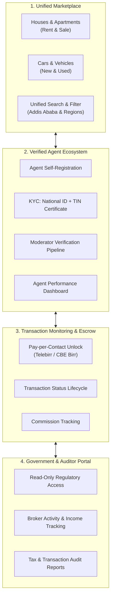
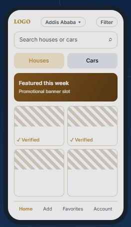
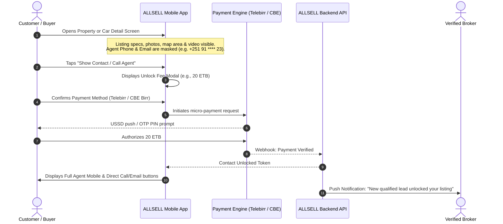
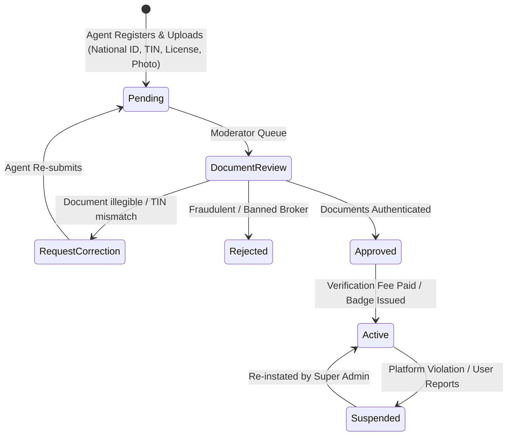
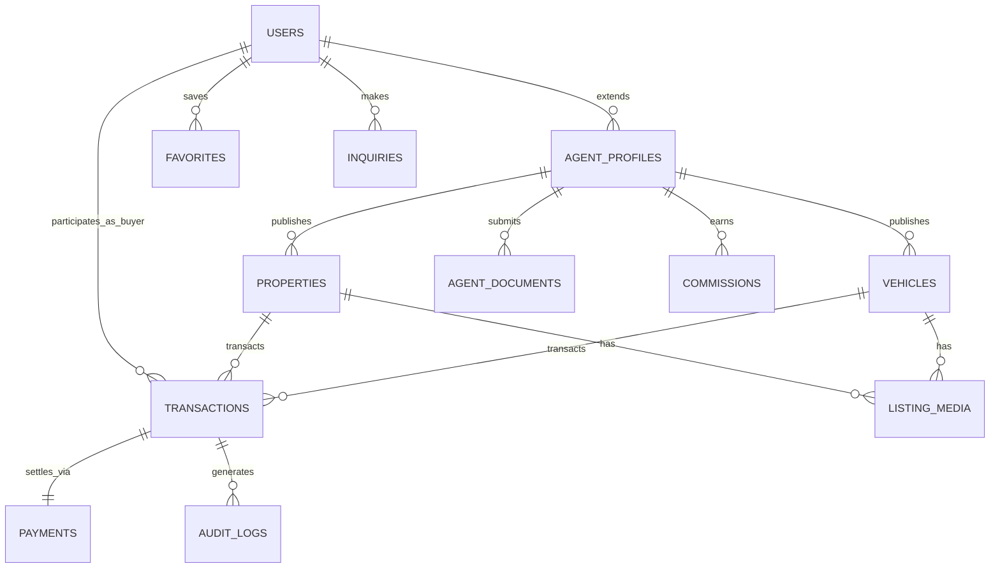
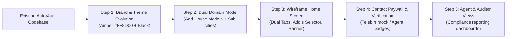

# ALLSELL System Design & Product Architecture
**Moto:** *"Connect & Simplify"*  
**Version:** 1.0 (Design & Architecture Specification)  
**Status:** Proposal / Ready for Review  

---

## 1. Executive Summary & Brand Identity

**ALLSELL** is a dual-vertical e-commerce and classifieds marketplace platform tailored specifically for the Ethiopian market, unifying **Real Estate (Houses/Properties)** and **Automotive (Cars/Vehicles)** into a seamless, verified, and transparent transaction ecosystem.

The core differentiator of ALLSELL lies in trust and institutional transparency:
1. **Verified Listings & Agents:** Strict broker onboarding with Ethiopian Tax Identification Number (TIN) and official ID document verification.
2. **Monetized Lead Reveal & Transaction Monitoring:** Contact reveal gated by micro-transactions (Telebirr, CBE Birr) to protect broker leads and eliminate fake inquiries.
3. **Government / Auditor Compliance Portal:** Dedicated read-only interface providing regulatory and tax monitoring for Ethiopian authorities.

### Brand Visual Identity & Color Palette

* **Primary Brand Amber:** `#FF8D00` (Warm, vibrant Ethiopian gold-amber representing commerce, energy, and value)
* **Primary Deep Black:** `#000000` / `#0D0E11` (Sophisticated contrast, typography, and premium framing)
* **Warm Surface Tint:** `#F7F5F0` / `#FAF9F6` (As seen in the official mobile wireframe, warm off-white for eye comfort)
* **Secondary Slate/Neutral:** `#E6E4DF` (Card outlines, inactive category chips)
* **Verified Accent Green/Gold:** `#16A34A` (Verified checkmark) / `#D97706` (Trust badges)
* **Typography:** Clean geometric sans-serif (e.g., Poppins / Plus Jakarta Sans) paired with elegant serif accents matching the brand identity.
* **Design Inspiration:** Modern clean utility combining the fast vehicle browsing of *Gari / Afrotie* with the accessible e-commerce layout of *Tinamart*.

---

## 2. Four Core Business Pillars

The ALLSELL platform is structured around four interlocking pillars:

1. **Marketplace:** High-velocity discovery for houses and cars with location-first filtering (Addis Ababa sub-cities, Weredas, regional cities).
2. **Agent Registration:** Agents submit TIN, business licenses, and government IDs. Only verified agents obtain the prominent "✓ Verified" trust badge.
3. **Transaction Monitoring:** Tracking the deal lifecycle from initial inquiry, paid contact reveal, offer, contract, to commission disbursement.
4. **Government Revenue & Tax Integration:** Distinctive compliance reporting compliant with Ethiopian legal frameworks, tracking agent gross turnover and estimated taxable liabilities.

---

## 3. User Roles & Permission Matrix (RBAC)

ALLSELL supports 6 distinct roles with isolated scopes of authority:

| Role | Primary Functions | Key Interfaces |
| :--- | :--- | :--- |
| **Customer / Buyer** | Browse listings, filter by sub-city/specs, pay fee to view agent contact info, save favorites, submit inquiries, report listings. | Mobile App (Customer Mode) |
| **Agent / Broker** | Submit KYC (TIN + ID), create and manage house & car listings, view lead inquiries, track commissions, monitor listing views. | Mobile App (Agent Dashboard) & Web Portal |
| **Moderator** | Review pending listings, inspect submitted documents (TIN/ownership), approve/reject/suspend listings, handle abuse reports. | Admin Web Panel (Moderator Suite) |
| **Administrator** | Manage users, configure category schemas, manage featured banners, adjust platform commission rates, view macro analytics. | Admin Web Panel |
| **Super Administrator** | Manage system settings, take automated/manual database backups, assign admin roles, configure payment gateways. | Admin Web Panel (Root) |
| **Auditor / Gov Office** | Read-only compliance portal: query agent registry, inspect aggregated & per-broker sales/rentals, export tax statements. | Dedicated Government / Auditor Portal |

---

## 4. Mobile App UI / UX Architecture (Flutter)

The mobile experience translates the wireframe and brand guidelines into an ergonomic, high-converting mobile application.

### 4.1 Home Screen Layout Breakdown

1. **Top Application Bar:**
   * **Left:** Brand Mark / Logo `AllSell` with the amber signature ring.
   * **Center-Right:** Location Selector Pill (Default: `Addis Ababa ▾`, tap triggers modal for sub-cities: *Bole, Kirkos, Yeka, Nifas Silk, Lideta, Kolfe Keranio, Arada, Gulele, Akaki Kality, Lemi Kura*, plus regional cities like *Hawassa, Bahir Dar, Adama, Dire Dawa*).
   * **Right:** Filter Icon Button (Opens advanced filter drawer/bottom sheet tailored to the currently active category).

2. **Universal Search Input:**
   * Prominent rounded search container: `"Search houses or cars..."` with clear button and mic/voice option.
   * Instant autocomplete suggesting popular makes (Toyota, Hyundai) and neighborhoods (Bole Atlas, CMC, Sarbet, Meganagna).

3. **Segmented Dual-Category Switcher:**
   * Two full-width touch-friendly segmented tabs:
     * `[ Houses ]` (Active: `#FF8D00` accent or warm beige fill with dark text)
     * `[ Cars ]` (Inactive: subtle slate `#E6E4DF` fill)
   * Smooth animated sliding pill transition that immediately updates the listing grid and filter options without reloading the screen.

4. **Promotional Banner Slot ("Featured this week"):**
   * High-contrast rounded banner card with amber-brown gradient (`#452205` to `#FF8D00`).
   * Dynamic admin-controlled banner: supports sponsor ads, verified dealer spotlights, or loan/mortgage promotions.

5. **2-Column Responsive Listing Grid:**
   * Modern 2-column card design matching wireframe:
     * 16:10 aspect ratio image thumbnail with photo counter badge (e.g. `1/8`).
     * `✓ Verified` badge in amber/gold for verified agent listings.
     * Price formatted in Ethiopian Birr: `ETB 14,500,000` or `ETB 45,000 / month`.
     * Title: e.g., *"3 Bed Modern Villa"* or *"Toyota RAV4 2023"*.
     * Micro specs chip row:
       * For Houses: `3 Bed · 2 Bath · 240 m²`
       * For Cars: `2023 · Auto · Petrol · 18k km`
     * Sub-city / Location indicator: `Bole, Addis Ababa`.

6. **Bottom Navigation Bar (4 Key Destinations):**
   * **Home:** Main dual-category discovery feed.
   * **Add (+):** Create a new listing (House or Car) with step-by-step media, location, and document upload.
   * **Favorites:** Saved listings bookmarked by the user for offline/quick access.
   * **Account:** User profile, mode switch to Agent Dashboard, language settings (English / Amharic), and help center.

---

### 4.2 Listing Details & Contact Paywall Flow

A crucial business requirement is the **Monetized Contact Reveal** mechanism:

---

## 5. Agent Verification & KYC Workflow

To build trust and eliminate fraudulent broker behavior, ALLSELL establishes a strict verification pipeline:

* **Verified Badge Benefits:**
  * Higher listing search ranking.
  * Distinctive gold/amber `✓ Verified` badge on all listings.
  * Access to transaction escrow tracking and direct bank settlement.

---

## 6. Government & Auditor Portal Architecture

The Auditor & Government Office dashboard provides regulatory bodies and internal finance teams with real-time insight into the platform's economic volume:

### Key Metrics Tracked
* **Registered & Active Agents:** Growth metrics and verified license counts.
* **Gross Transaction Volume (GTV):** Total Sales Value (ETB) and Total Rental Value (ETB).
* **Platform & Broker Commission:** Transparent split calculations.
* **Tax Reporting Interface:**
  * Computes standard withholding and turnover taxes based on Ethiopian Revenue Authority (ERA) parameters.
  * Exportable Monthly & Annual Statements (PDF / CSV / Excel).
  * Immutable Audit Log tracking every listing approval, price change, and verified transaction.

---

## 7. Data Models & Database Schema

The database design provides clear separation between real estate and automotive specifications while sharing common marketplace primitives (users, transactions, media, payments).

### 7.1 Core Entities

#### `properties` (Houses / Real Estate)
* `id` (UUID, Primary Key)
* `agent_id` (UUID, FK -> `users.id`)
* `listing_type` (Enum: `FOR_SALE`, `FOR_RENT`)
* `property_type` (Enum: `VILLA`, `APARTMENT`, `CONDOMINIUM`, `COMMERCIAL`, `LAND`, `TOWNHOUSE`)
* `title`, `description` (Text)
* `price` (Decimal), `currency` (Default: `ETB`)
* `city`, `sub_city`, `wereda`, `house_number`, `address`
* `latitude`, `longitude` (PostGIS / Coordinates)
* `bedrooms`, `bathrooms`, `area_sqm`, `floor_number`, `year_built`
* `furnishing_status` (Enum: `UNFURNISHED`, `SEMI_FURNISHED`, `FULLY_FURNISHED`)
* `utilities` (JSONB: `{ water: true, backup_generator: true, 3_phase_electricity: true, internet: true }`)
* `features` (Array: `['parking', 'garden', 'balcony', 'security_guard', 'elevator']`)
* `verification_status` (Enum: `PENDING`, `VERIFIED`, `REJECTED`)
* `status` (Enum: `ACTIVE`, `INACTIVE`, `RENTED`, `SOLD`)

#### `vehicles` (Cars / Automotive)
* `id` (UUID, Primary Key)
* `agent_id` (UUID, FK -> `users.id`)
* `make` (String, e.g. `Toyota`), `model` (String, e.g. `RAV4`), `year` (Integer)
* `condition` (Enum: `BRAND_NEW`, `ETHIOPIAN_USED`, `FOREIGN_USED / IMPORT`)
* `price` (Decimal), `currency` (`ETB`)
* `mileage_km` (Integer)
* `transmission` (Enum: `AUTOMATIC`, `MANUAL`)
* `fuel_type` (Enum: `PETROL`, `DIESEL`, `ELECTRIC`, `HYBRID`)
* `engine_capacity_cc` (Integer / String)
* `body_type` (Enum: `SUV`, `SEDAN`, `HATCHBACK`, `PICKUP`, `VAN`, `MINIVAN`)
* `color` (String)
* `city`, `sub_city` (Location)
* `verification_status` (Enum: `PENDING`, `VERIFIED`, `REJECTED`)
* `status` (Enum: `ACTIVE`, `INACTIVE`, `SOLD`)

#### `transactions` & `payments`
* `id` (UUID)
* `buyer_id`, `seller_id`, `agent_id`
* `listing_type` (`PROPERTY` / `VEHICLE`), `listing_id`
* `amount` (Decimal), `commission_amount` (Decimal)
* `payment_provider` (`TELEBIRR`, `CBE_BIRR`, `MPESA`, `BANK_TRANSFER`)
* `payment_reference` (Telebirr Transaction ID)
* `status` (`INITIATED`, `PAYMENT_PENDING`, `PAID`, `COMPLETED`, `CANCELLED`, `DISPUTED`)

---

## 8. Migration Plan: AutoVault to ALLSELL

The current workspace contains **AutoVault** (a car marketplace demo). We will systematically evolve it into ALLSELL rather than discarding good code:

| Phase | Scope | Deliverables |
| :--- | :--- | :--- |
| **Phase 1: Design & Alignment** *(Current)* | Formalize Architecture & UI Design | System Design Document, Schema, Screen Specs, User Approval. |
| **Phase 2: Visual & Theme Rebrand** | Transform colors, typography, assets | New `AllSellTheme` (`#FF8D00`, `#000000`, warm off-white), incorporate official logo and brand assets. |
| **Phase 3: Dual-Category Home Screen** | Match wireframe exactly | Header with Addis Ababa selector, search, `[Houses]` & `[Cars]` segmented tab switcher, promo banner, 2-column verified grid. |
| **Phase 4: Real Estate & Car Details** | Full detail screens for both verticals | House specs (bed/bath/sqm/water/generator) + Car specs, image carousel, video preview, paywall modal for revealing contact. |
| **Phase 5: Agent Dashboard & KYC** | Agent portal in app | Dashboard KPIs (Active, Pending, Sold, Sales ETB, Commission), listing submission wizard with ID/TIN upload. |
| **Phase 6: Backend & Auditor Engine** | Node.js + DB schema & mock API | REST endpoints for listings, Telebirr payment simulation, and read-only auditor/tax endpoints. |

---

## 9. Alignment & Decision Checkpoints

Before initiating code changes, please review these key design choices:

1. **Contact Paywall Pricing Model:** Should the fee to unlock seller phone/email be a flat nominal fee (e.g., 20 - 50 ETB via Telebirr) or should users get a limited number of free contact reveals per month (freemium)?
2. **Auditor / Government Access Level:** Should the Auditor portal be integrated as a dedicated restricted tab/sub-route in the web/mobile app, or built as an independent web application?
3. **Category Switcher Behavior:** When switching between `Houses` and `Cars`, should the location filter (e.g. `Bole`) stay preserved, while the detailed filters (Bedrooms vs Transmission) dynamically swap? (Recommended: Yes).
